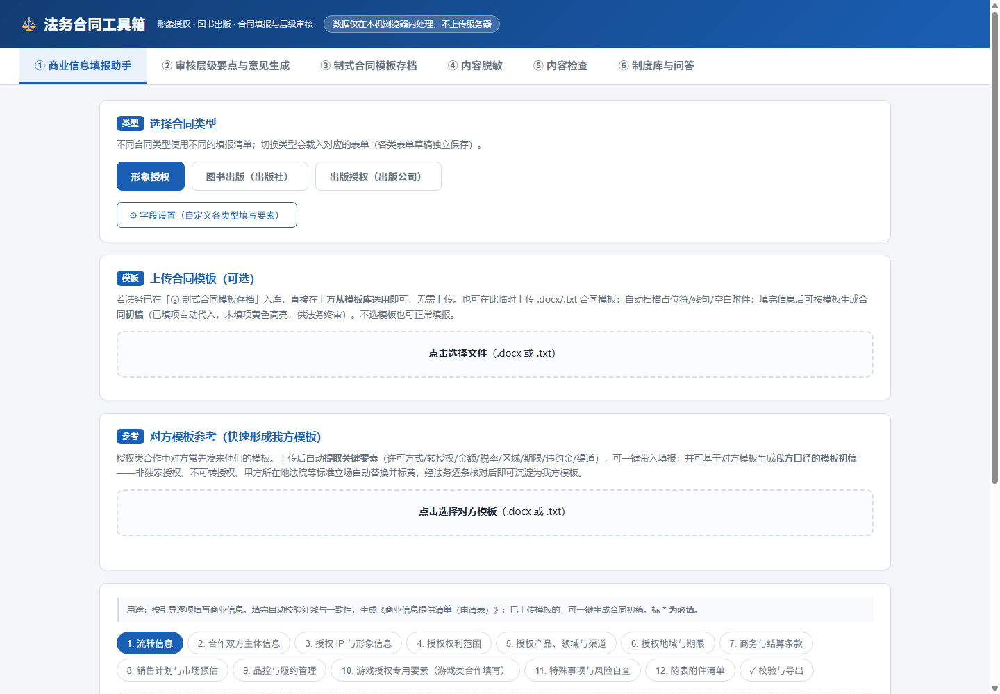
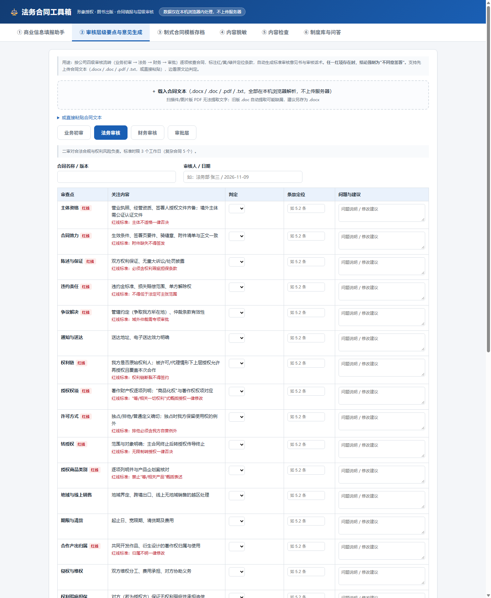
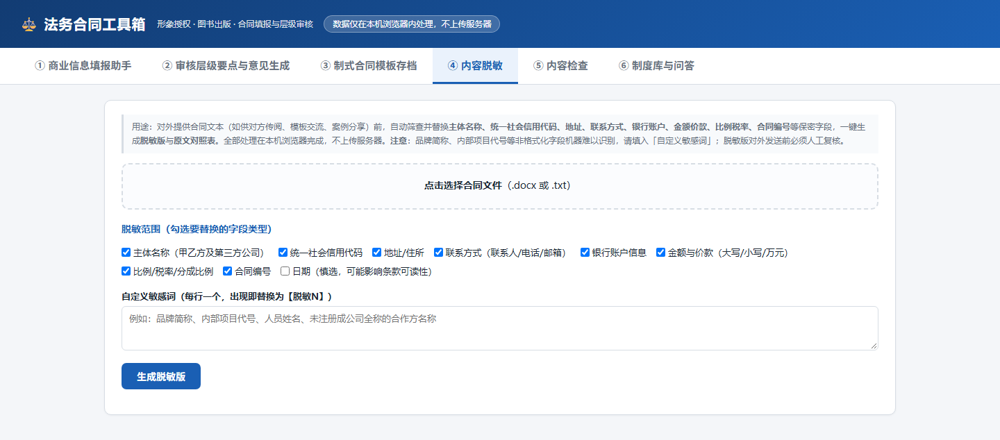
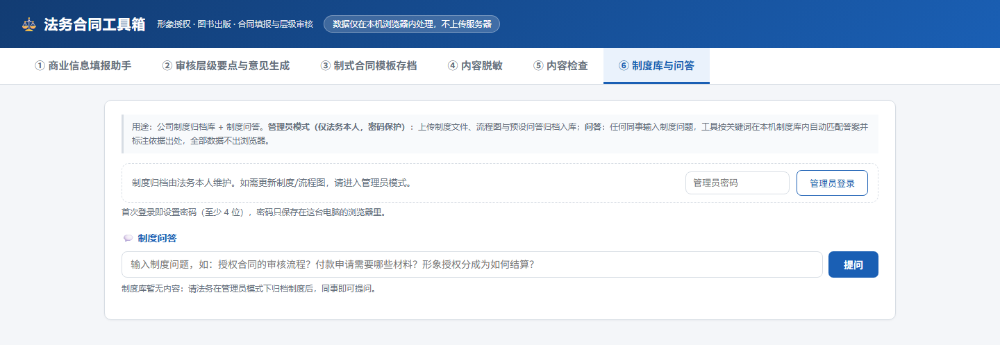

# ⚖️ Legal Contract Toolbox (法务合同工具箱)

 -blue) 

**⚡ Try it online (no install needed): <https://ljinyu1219.github.io/legal-contract-toolbox/>**

[中文说明 →](README.md)

A **single-file, pure-frontend, zero-backend** contract toolbox built from the real daily workflow of an in-house legal team at an IP / content company. Everything runs in your browser — **no server, no upload, no data ever leaves your machine**.

> ⚠️ Disclaimer: this tool is for learning and internal-efficiency reference only. It is not legal advice. Always have a licensed attorney review formal contracts.

## What it does

### 1. Business-info fill-in assistant

- Step-by-step checklists for three contract types (image licensing / game licensing / book publishing), fully customizable via the ⚙ Field Settings panel;
- A **red-line validation engine** runs after every fill: summarized/potentially unlimited license grants, missing exclusivity carve-outs, unrestricted sublicensing, royalty calculation bases, placeholder leftovers, and dozens more;
- Exports a Word-format "Business Information Form" for the counterparty to complete.

### 2. Counterparty template intake

- Upload the other side's contract (.docx/.txt) → auto-extracts key terms: license type, sublicensing, amounts, tax rate, territory, term, penalty clauses;
- One click imports recognized fields into the form;
- Generates a first draft in **your** standard position (exclusive → non-exclusive, sublicensing → not allowed without written consent, jurisdiction → licensor's venue), auto-replaced and **highlighted in yellow** for attorney review.

### 3. Template archive & draft generation

- Archive your standard contract templates by category; colleagues pick from the archive instead of re-uploading;
- Auto-scans templates for placeholders, broken sentences, dangling clause references;
- Generates a Word draft from archived templates with unfilled placeholders highlighted.

### 4. Content redaction

- Before sharing a contract externally, auto-detects and masks **party names (auto-identifies buyer/seller/third parties), unified social credit codes, addresses, contacts (names/phones/emails), bank accounts, amounts (Chinese-capital & numeric), percentages/tax rates, contract numbers**;
- Custom sensitive keywords supported;
- Produces a **redacted Word file** plus an **original-vs-redacted comparison table** (for internal records only).

### 5. Content QA

- **Amount checks**: parses Chinese-capital amounts and cross-checks numeric amounts line by line (mismatch → red), missing capital form, unspecified tax-inclusion, zero amounts, ratio > 100%;
- **Common typos & wording**: misused legal terms (e.g., "订金" vs "定金"), void "final interpretation right" clauses;
- **Punctuation & clause references**: dangling "Article X" references, duplicate/skipped clause numbering, invalid dates;
- Red/yellow findings list with line numbers + Word report.

### 6. Tiered review (business → legal → finance → approval)

- Role-specific checklists: 22 legal items, 19 finance items;
- Per-item green/yellow/red verdict + clause location + suggested language; **any red item forces "do not sign"**;
- Auto-generates a Word review opinion and a one-page executive summary;
- Built-in negotiation/rejection scripts per layer, fully extensible;
- Load the contract text itself (.docx/.doc/.pdf/.txt or paste) alongside the checklist — searchable, click-to-copy for clause location.

### 7. Policy base & Q&A

- **Admin mode (password protected)**: archive internal policies (.docx/.doc/.pdf/.txt), flowcharts (images), and canned Q&A pairs — all local;
- Colleagues type a question; the tool searches the local policy base and answers with highlighted excerpts and source citations; matching flowcharts display inline.

## Screenshots

| Fill-in assistant | Tiered review |
|---|---|
|  |  |

| Redaction | Policy Q&A |
|---|---|
|  |  |

## Privacy & data security

- Everything (inputs, verdicts, uploaded contract text) is processed and stored **only in your browser** (localStorage). Nothing touches a server;
- Settings, template archives and policy archives can be exported/imported as JSON for team distribution — still without any server.

## Usage

**Fastest: open the [online version](https://ljinyu1219.github.io/legal-contract-toolbox/)**, or double-click `index.html` locally. Loading .docx files needs network access for mammoth.js (CDN); .txt workflows are fully offline.

## Who it's for

- Small companies with no legal department — one in-house counsel (or even a non-lawyer admin) handling contracts;
- IP licensing, publishing and content-production businesses that review similar contracts repeatedly;
- Teams that refuse to upload confidential contracts to any third-party cloud service.

## Tech

Vanilla HTML/CSS/JS in a single file — no framework, no build step. mammoth.js for in-browser .docx parsing, pdf.js for PDF text extraction.

## License

[MIT](LICENSE)
